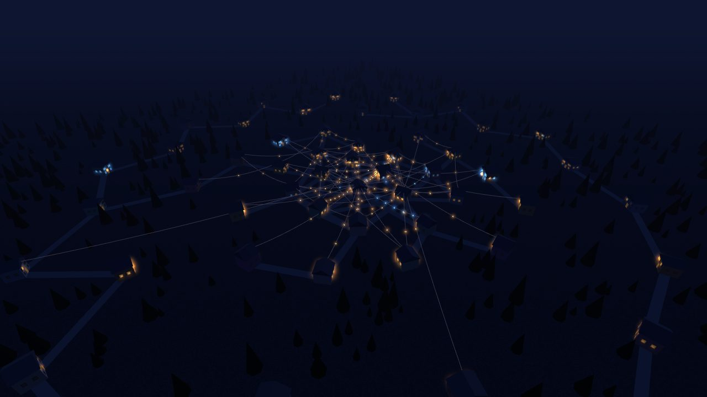

# Night Walk

Walk through the Blygger thicket at night. Every blyg listed in the [public directory](https://blygger.com/) is a house on a lane. Every quote between two blygs is a light strung between their houses. Walk close to a string and you overhear the exchange in the authors' own words, with a link to each post.

Venkatesh Rao described reading the thicket as walking past your neighbours' yards and overhearing them, with neighbourhood lights that should be pleasant rather than a contest. Night Walk builds that scene from the live protocol.

**[Open Night Walk](https://fishbiscuit.github.io/night-walk/)**



[Watch the one-minute walkthrough](https://fishbiscuit.github.io/night-walk/media/night-walk.mp4), recorded from the live thicket on 24 November 2026.

## What you're seeing

- **Lit window:** one of a blyg's ten most recent posts. It is brightest on the day it was published and dims over the following weeks.
- **Blue window:** a post that includes AI-generated passages. The post card names the model.
- **Flickering window:** a post revised after publication. The card shows its changelog.
- **Shutters:** a withdrawn post.
- **Lanterns by the door:** a burst, meaning a thread and its fragments published together.
- **String of lights:** two blygs that have quoted each other, with one bulb per quote in publication order. If the quoted post has been revised since, the card says which version the quote kept and which version the source is now.
- **Dark house:** a blyg that doesn't let browsers read it. Quotes from its neighbours still reach its door.

Blygs that quote each other are placed as neighbours. Houses are not sized or ranked by activity, and nothing counts followers, likes or posts.

## Using it

- **Start walking:** places you beside the most recent exchange between two people.
- **Moving:** drag to look around, click the ground to walk there, or use W A S D and the arrow keys. Shift walks faster.
- **Reading:** click a bulb, a window or a house to open its post.
- **Above:** switches to the aerial view. **Lane** lists every house in the order it joined. **Find** searches the quotes and replies, and can walk you through matching exchanges in order.
- **Time:** the slider sets the date. ▶ replays the thicket from September: houses appear as blygs are listed, and strings go up as people quote each other.
- **Linking to a house:** `#blyg=host/path` opens at that blyg's door, for example `#blyg=venkateshrao.com/blyg`.

## How it reads Blygger

Everything is fetched by the visitor's browser at load time, following [Blygger v0.4](https://blygger.org/spec/0.4/):

1. The directory at `blygger.com/blygs.json`.
2. Each blyg's `blyg.json` manifest, honouring its `items` and `item` paths.
3. Each items index, which gives each item's kind, creation time, current version and withdrawals.
4. Up to 24 of each blyg's most recent item documents since 1 September 2026. These provide `transclusions` and `stub_of` (with the excerpt and version the quoting author captured), `generated` (the model named for AI passages) and `changelog`.

A quote is drawn when an item on one origin transcludes or stubs an item on another. Bursts follow the 15-minute window from RFC-3. A quote "kept version N" when the source's index now reports a later version.

Nothing is sent to or stored on a server. The browser keeps fetched items in local storage so a return visit loads faster. Post text is shown as plain text with publisher markup removed, and every line links to its source.

On 24 November 2026, 48 of the 54 listed blygs allowed cross-origin reads. The other six are shown as dark houses.

## Run locally

Requires Node 18 or newer. There are no dependencies to install.

```sh
node tools/serve.mjs . 8790
```

Open `http://127.0.0.1:8790/`. The page needs network access to the blygs it reads.

## Credits

Three.js r180 is included under its [MIT license](vendor/three.LICENSE.txt). The Blygger specification is published under CC BY 4.0. Post text belongs to its authors and is read live from their own sites.
